# ha-tide-card

[](https://www.home-assistant.io/integrations/marketplace/)
[](https://github.com/juju35/ha-tide-card/actions/workflows/hacs.yml)
[](https://github.com/juju35/ha-tide-card/actions/workflows/validate.yml)
[](https://github.com/juju35/ha-tide-card/actions/workflows/lint.yml)
[](https://github.com/juju35/ha-tide-card/releases/latest)
[](https://github.com/juju35/ha-tide-card/blob/main/LICENSE)
[](https://buymeacoffee.com/julienstep9)

<p align="center">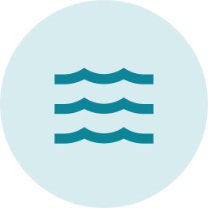</p>

<p align="center">
  <a href="https://github.com/KipK/marees_france"></a>&nbsp;&nbsp;
  <a href="https://www.home-assistant.io/integrations/noaa_tides/"></a>&nbsp;&nbsp;
  <a href="https://www.home-assistant.io/integrations/worldtidesinfo/">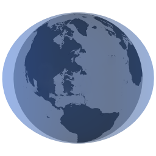</a>&nbsp;&nbsp;
  <a href="https://github.com/jugla/worldtidesinfocustom"></a>&nbsp;&nbsp;
  <a href="https://github.com/ianbyrne/hass-ukho_tides"></a>&nbsp;&nbsp;
  <a href="https://github.com/tmjo/ha-norwegiantide">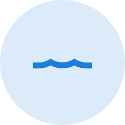</a>
</p>

A Lovelace card for the **tides** of a port: the curve of the day with the height now, the high and low waters, the coefficients of the coming days, and a sea in the header that rises and falls with the tide.

[](https://my.home-assistant.io/redirect/marketplace_repository/?owner=juju35&repository=ha-tide-card&category=plugin)

| Card | Type | What it shows |
|---|---|---|
| [Tide](#screenshots) | `custom:tide-card` | The curve of the day, the high and low waters and the coefficients, under an illustrated sea. |
| [Tide mini](#tide-mini) | `custom:tide-mini-card` | The next high or low water and the coefficient on two lines, with a zoom to the full card. |

| Rising | Spring tide |
|---|---|
| 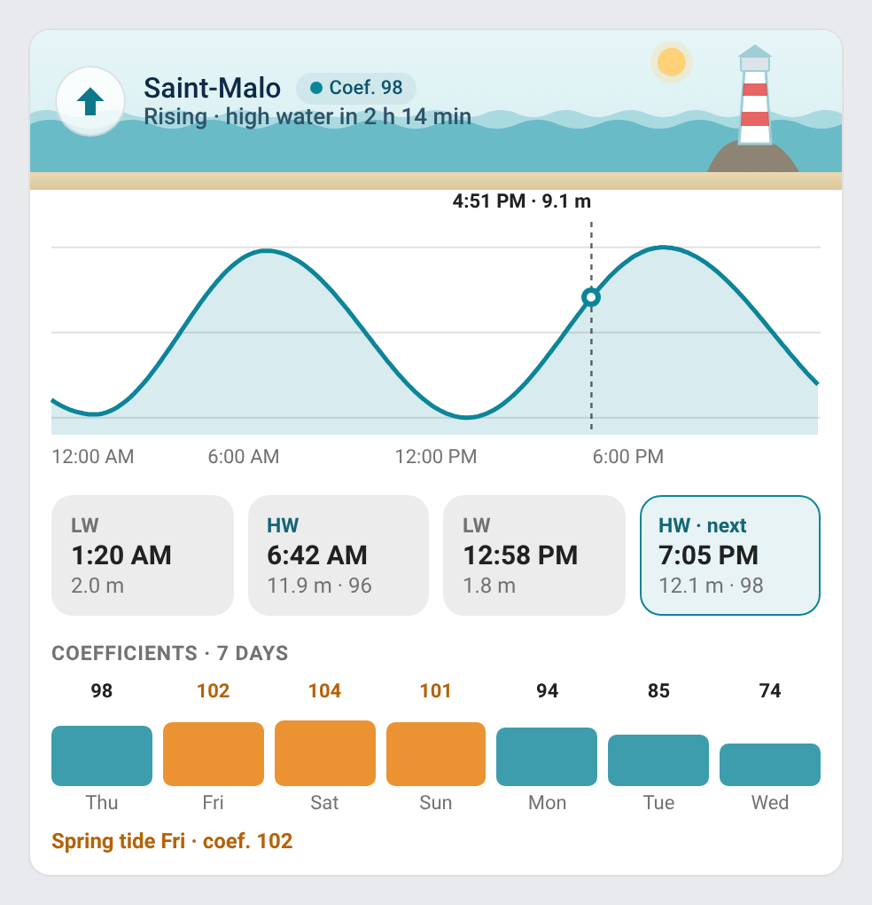 | 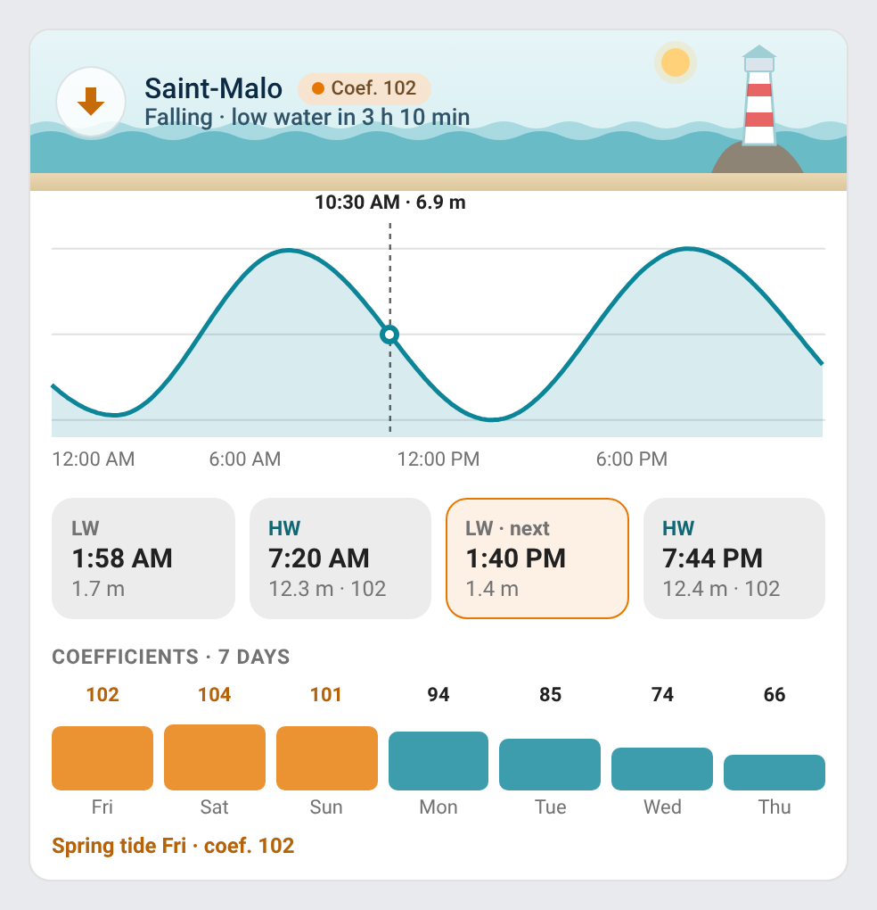 |

## Features

- **The curve of the day**, 0 h to 24 h: the water height measured by the integration when it gives one, otherwise drawn between the high and low waters; *now* marked with its time and height
- **High and low waters**: the day's tides (then the next ones) as tiles with their time, height and coefficient, the next one outlined
- **Coefficients of the coming 7 days** as bars, spring tides (100 and more) in amber, with the next spring tide
- **Illustrated header**: a sea whose level follows the tide between the day's lowest and highest waters, waves that drift, a lighthouse; by night (dark theme) the moon and the lighthouse's light; the status pill shows the coefficient, the badge's arrow the trend
- **Mini card**: the title and the coefficient (or the trend), then the next high or low water, its height and when; its zoom button opens the full card in place
- **One adapter per integration**, and a manual mapping for anything else (a REST or template sensor)
- **Tap the curve or the tiles** to open the tide entity's details
- Visual editor for both cards, light and dark themes, 22 languages, no external dependency

## Supported integrations

The card has no integration of its own: it reads the entities of a tide integration. Pick the integration's sensor as `entity`; the card recognises it by its platform or its attributes.

| | Integration | High / low waters | Heights | Height now | Coefficients | Curve |
|:---:|---|---|---|---|---|---|
|  | [Marées France](https://github.com/KipK/marees_france) (Marketplace, SHOM, France) | several days | yes | yes | 7 days | measured |
|  | [NOAA Tides](https://www.home-assistant.io/integrations/noaa_tides/) (built in, USA) | next 3 | yes | estimated | no | drawn |
|  | [NOAA Tides fork](https://github.com/Flight-Lab/HA_Noaa_Tides) (custom, USA; also [jshufro's](https://github.com/jshufro/home_assistant_noaa_tides)) | last, next, following | yes | estimated | no | drawn |
|  | [World Tides](https://www.home-assistant.io/integrations/worldtidesinfo/) (built in, worldwide) | next high and low | yes | estimated | no | drawn |
|  | [World Tides Info Custom](https://github.com/jugla/worldtidesinfocustom) (Marketplace, worldwide) | next high and low | yes | yes | no | drawn |
|  | [UKHO Tides](https://github.com/ianbyrne/hass-ukho_tides) (custom, UK) | several days | yes | estimated | no | drawn |
|  | [Norwegian Tide](https://github.com/tmjo/ha-norwegiantide) (custom, Kartverket, Norway) | next high and low | yes | yes | no | drawn |
| | Anything else, through `mapping` (Stormglass REST sensors, template sensors…) | next high and low | if mapped | if mapped | current one | drawn |

*Drawn*: a half cosine from each high or low water to the next (the rule of twelfths, smoothed), carried on by half tidal cycles past the known ones; the card then says so under the curve. Coefficients are a French measure: only Marées France and a mapped sensor give them. Norwegian Tide has no logo in the Home Assistant brands repository: its icon here is a wave.

## Installation

### Via the Marketplace (recommended)

Click the button below to add the repository directly:

[](https://my.home-assistant.io/redirect/marketplace_repository/?owner=juju35&repository=ha-tide-card&category=plugin)

Or manually:

1. Open **Settings → Marketplace → Add from link** (top right; this needs a GitHub account connected)
2. Add `https://github.com/juju35/ha-tide-card` — Type: **Dashboard**
3. Open **Tide Card** and click **Install**
4. Clear your browser cache and refresh

The Marketplace registers the dashboard resource for you.

### Manual

1. Download `ha-tide-card.js` and the `ha-tide-card.i18n.*.js` translation files from the [latest release](https://github.com/juju35/ha-tide-card/releases/latest)
2. Copy them all to `/config/www/` (without the translation files, the cards show in English)
3. Go to **Settings → Dashboards → Resources** → Add resource:
   - URL: `/local/ha-tide-card.js`
   - Type: **JavaScript Module**
4. Clear your browser cache and refresh

## Configuration

Every option is in the visual editor; `mapping`, an object, is written as YAML in its advanced section. In YAML:

```yaml
# A Marées France port: its "current tide" sensor (any sensor of the port works)
type: custom:tide-card
entity: sensor.saint_malo_current_tide

# A NOAA Tides station, with a title
type: custom:tide-card
entity: sensor.tides
title: Harbor

# Anything else: a manual mapping (each value an entity, or { entity, attribute })
type: custom:tide-card
title: Beach
mapping:
  height: sensor.tide_height
  next_high: sensor.stormglass_next_high_tide
  next_low: sensor.stormglass_next_low_tide
  next_high_height:
    entity: sensor.stormglass_next_high_tide
    attribute: height

# Two lines on a phone dashboard
type: custom:tide-mini-card
entity: sensor.saint_malo_current_tide
```

| Option | Type | Default | Description |
|---|---|---|---|
| `entity` | string | the first tide sensor | Both: the tide integration's sensor |
| `title` | string | the port's name (Marées France), else `Tides` | Both: card title |
| `show_title` | boolean | `true` | Both: show the title |
| `show_subtitle` | boolean | `true` | Both: the trend and when the next high or low water comes |
| `navigation_path` | string | | Both: a tap on the header opens this dashboard path |
| `show_curve` | boolean | `true` | Both: the curve of the day |
| `show_extremes` | boolean | `true` | Both: the high and low water tiles |
| `show_coefficients` | boolean | `true` | Both: the coefficients of the coming days (when the integration gives them) |
| `mapping` | object | | Both, YAML only (in the editor's advanced section): `height`, `trend` (`rising` / `falling`, `flow` / `ebb`…), `next_high`, `next_high_height`, `next_low`, `next_low_height`, `coefficient` — each an entity id or `{ entity, attribute }`; used when `entity` is not a known tide sensor |
| `illustration` | boolean | `true` | Both: the illustrated header (`false`: the classic header) |
| `illustration_theme` | string | `auto` | Both: `auto` (follows the Home Assistant theme: night with a dark theme, day with a light theme), `day` or `night` |
| `animations` | boolean | `true` | Both: the waves and the lighthouse |
| `zoom` | boolean | `true` | Mini card: the zoom button |
| `language` | string | Home Assistant's | Advanced: one of the [languages](#translations) |

## Screenshots

| Rising (Marées France) | Spring tide, falling |
|---|---|
|  |  |
| 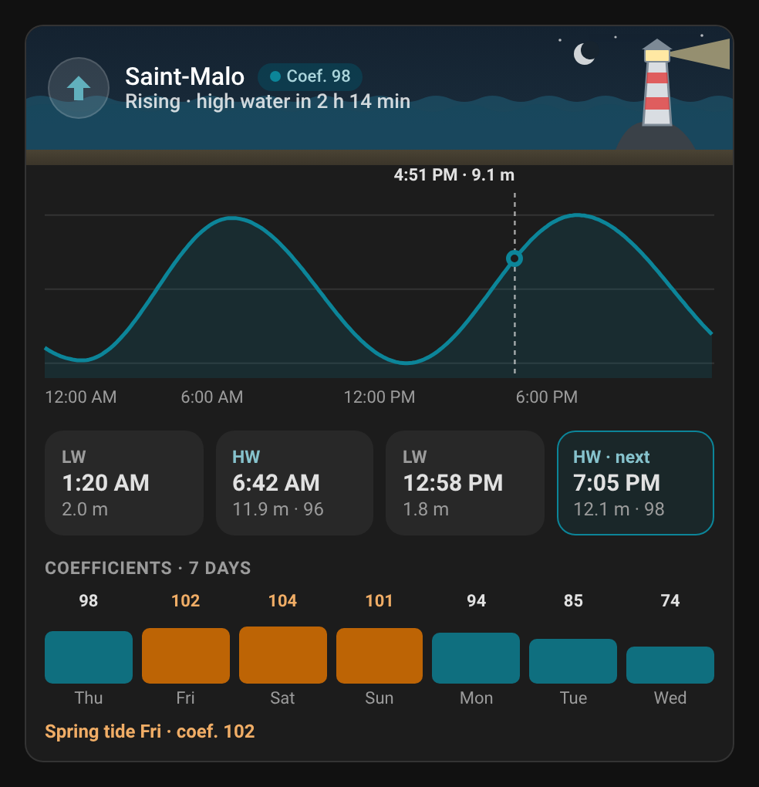 | 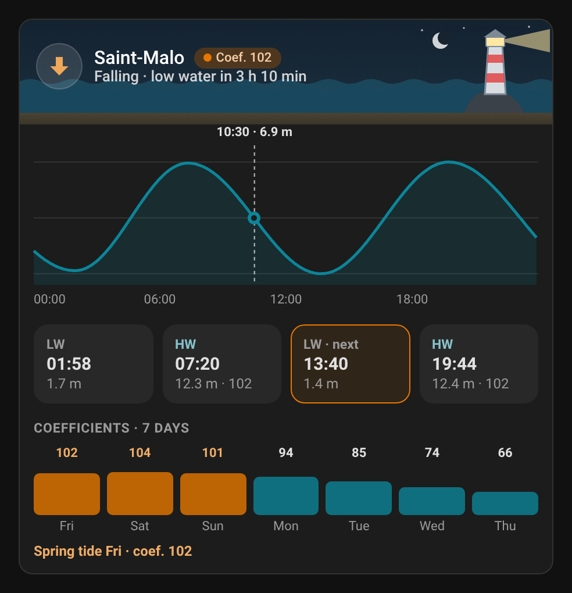 |

| NOAA Tides (curve drawn) | No tide data | Narrow |
|---|---|---|
| 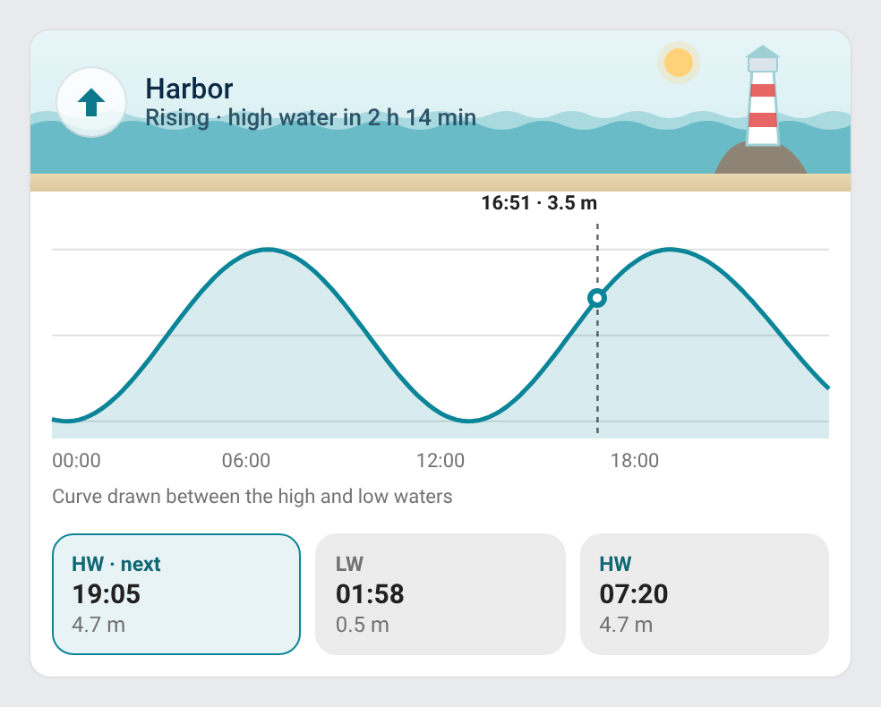 | 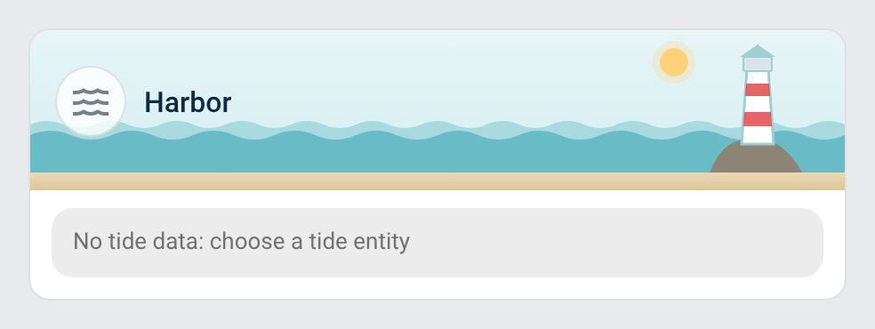 | 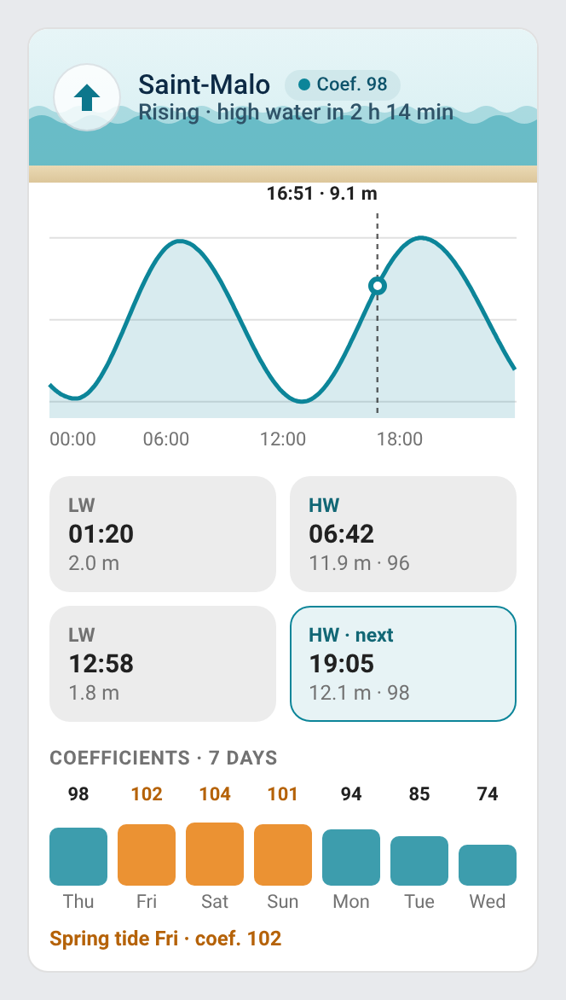 |
| 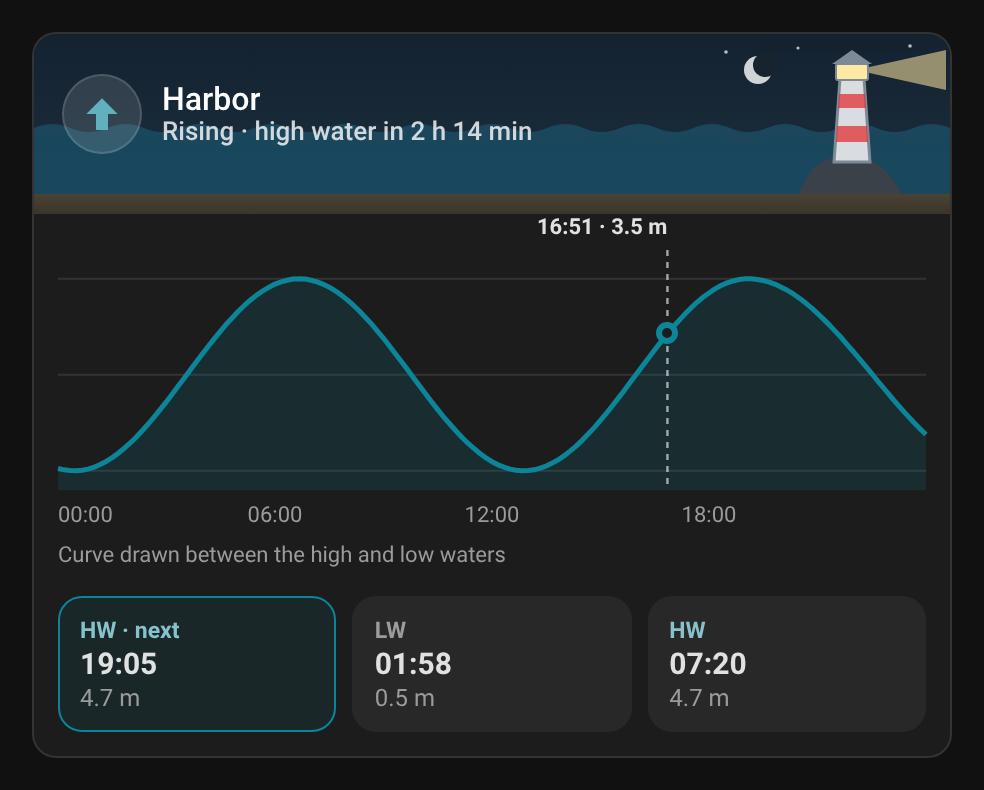 | 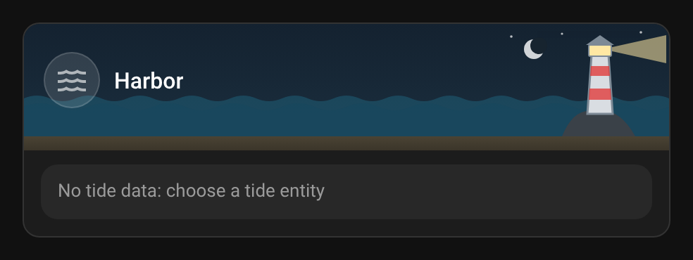 | 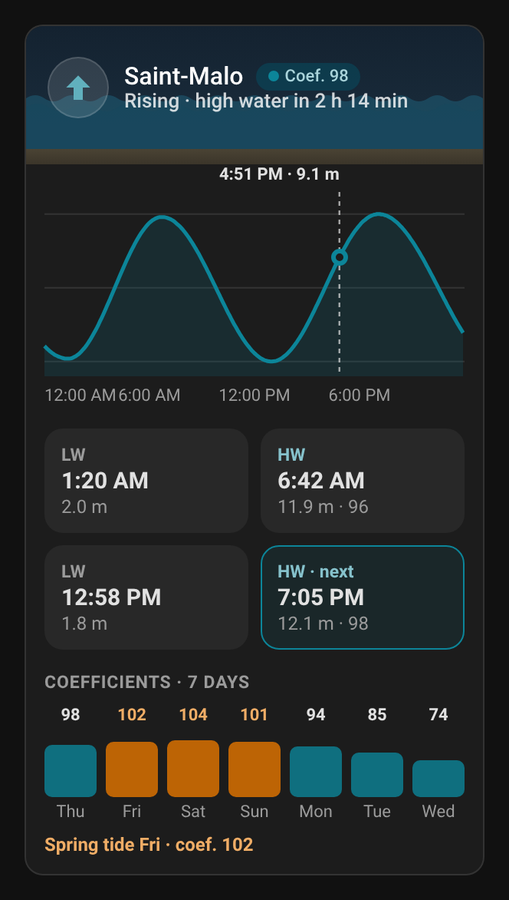 |

**Waves animation**: the waves drift; by night the lighthouse shines (still with `animations: false`, or when the system asks for reduced motion).

| Light | Dark |
|---|---|
|  | 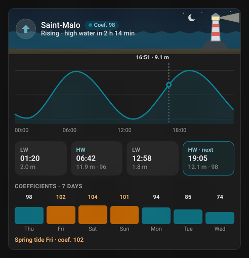 |

### Tide mini

| Rising | Spring tide | Zoomed in |
|---|---|---|
| 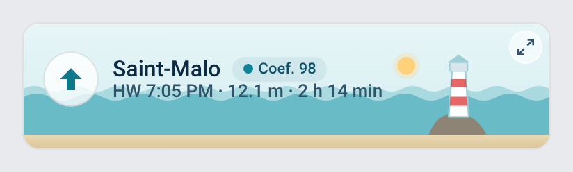 | 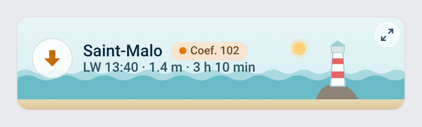 | 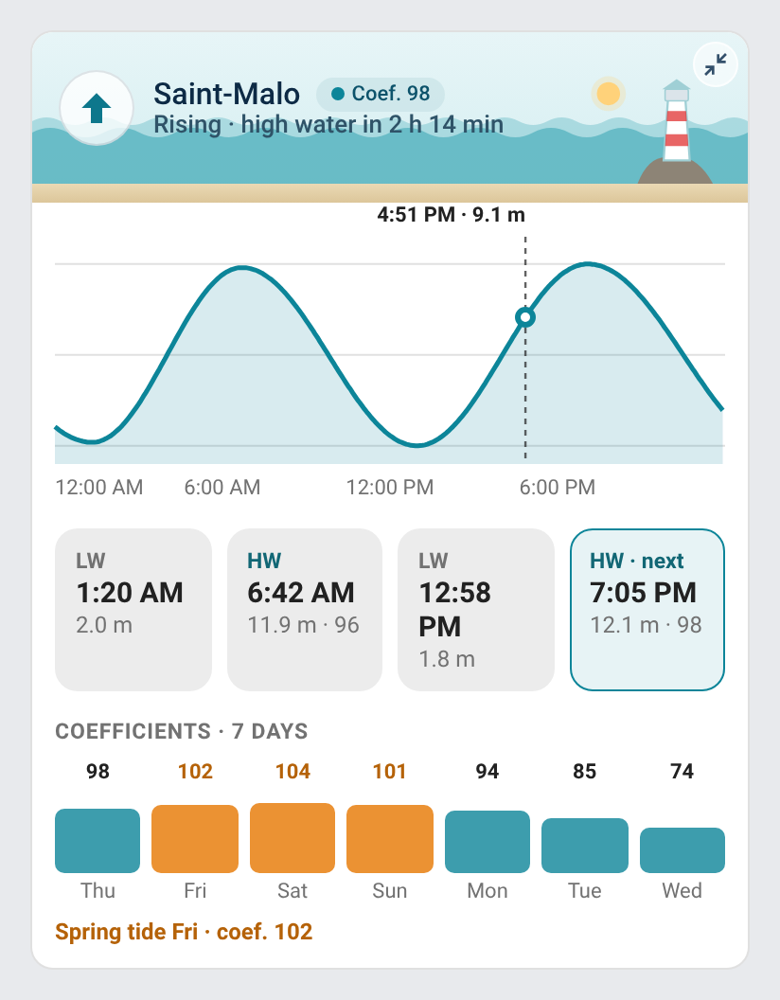 |
| 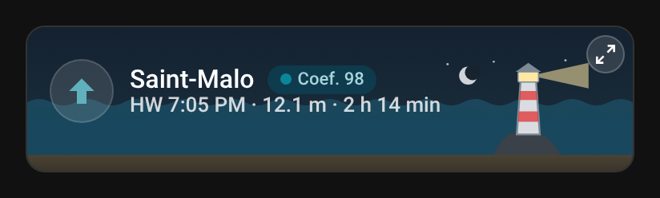 | 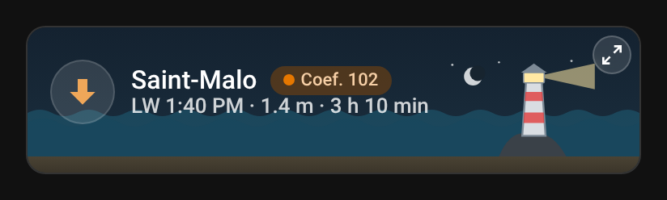 | 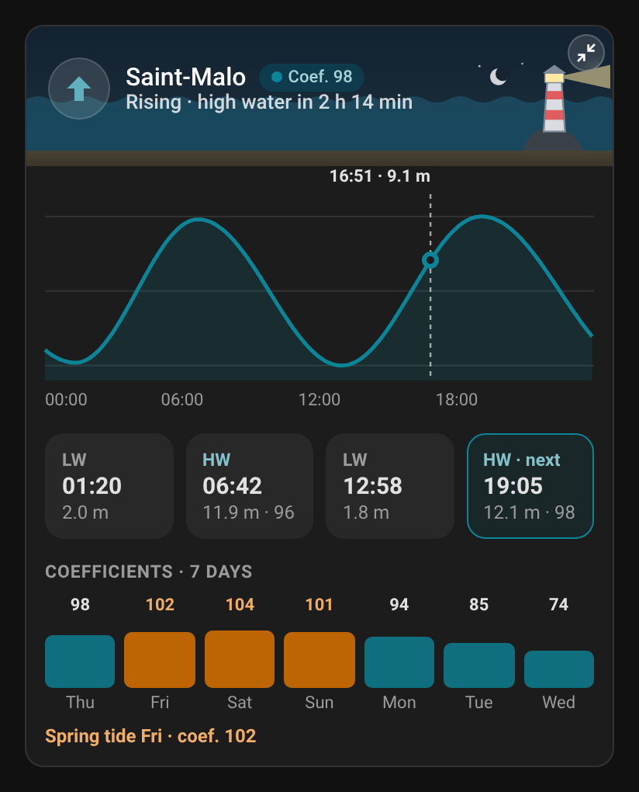 |

**Mini card animation**: the same sea and lighthouse on the mini card's banner.

| Light | Dark |
|---|---|
| 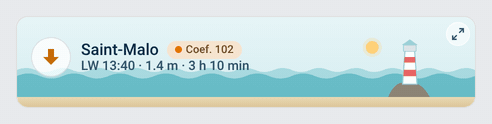 | 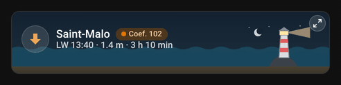 |

## How it works

- **Marées France**: the card asks the integration's websocket commands for the tides of the coming days (`marees_france/get_tides_data`), the water levels of the day (`get_water_levels`) and the coefficients of the week (`get_coefficients_data`), at first, every 30 minutes and at each new day; the port's *current tide* sensor gives the height now and the trend
- **NOAA Tides**: the next tide from the state (*High tide at 3:41 PM*, its height taken from the next tide of its type), the two after it from `high_tide_time` / `low_tide_time` and their heights
- **NOAA Tides fork**: `last_tide_*`, `next_tide_*` and `following_tide_*` (time and level)
- **World Tides**: `high_tide_time_utc`, `low_tide_time_utc` and their heights; `current_height` and `tide_tendancy` on the custom integration
- **UKHO Tides**: the `predictions` list of the coming days (high and low waters told apart by their neighbours), *Rising* / *Falling* in the state
- **Norwegian Tide**: `next_tide_high` / `next_tide_low` and the forecast height in the state, centimetres shown in metres
- **Trend**: the integration's, else rising when the next tide is a high water
- **Units**: the sensor's (`m` or `ft`), else the unit system's
- **Header**: the sea stands between the day's lowest and highest waters; the badge's arrow follows the trend, in cyan rising, blue falling, amber on a spring tide
- **Read only**: the card calls no action

## Development

```bash
npm install
npm run build        # stamps the version of package.json into dist/ha-tide-card.js
npm run check        # builds and checks the bundle (run in CI)
npm test             # unit tests
npm run screenshots  # renders the cards with a mock port and station into screenshots/ (and the GIFs, needs ffmpeg)
```

The source is split into ES modules under `src/shared/` (entry `src/shared/index.js`); `npm run build` assembles them (`scripts/bundle.mjs`) into the single file the Marketplace serves.

`dist/` is not committed: `npm run build` creates it locally, CI builds it on every push, and the release workflow attaches the built files to the release, which is where the Marketplace installs them from.

### Releasing

1. Bump `version` in `package.json`
2. Add a `## <version>` section at the top of [CHANGELOG.md](https://github.com/juju35/ha-tide-card/blob/main/CHANGELOG.md)
3. Merge a `feat` or `fix` pull request: the **Release** workflow builds the card, creates the tag and the GitHub release with the changelog section as notes, and attaches `ha-tide-card.js` and its translation files

## Translations

The card auto-detects the language from your Home Assistant settings. Currently supported:

| Language | Code |
|---|---|
| English | `en` |
| Français | `fr` |
| Deutsch | `de` |
| Español | `es` |
| Српски | `sr` |
| Srpski (latinica) | `sr-Latn` |
| Italiano | `it` |
| Nederlands | `nl` |
| Português (Portugal) | `pt` |
| Polski | `pl` |
| Română | `ro` |
| Dansk | `da` |
| Svenska | `sv` |
| Български | `bg` |
| Русский | `ru` |
| Українська | `uk` |
| Magyar | `hu` |
| Slovenčina | `sk` |
| Čeština | `cs` |
| Slovenščina | `sl` |
| Latviešu | `lv` |
| Ελληνικά | `el` |

Contributions for additional languages are welcome!

## License

[MIT](https://github.com/juju35/ha-tide-card/blob/main/LICENSE)

## Support

If you find this project useful, you can support its development:

<a href="https://buymeacoffee.com/julienstep9"></a>
